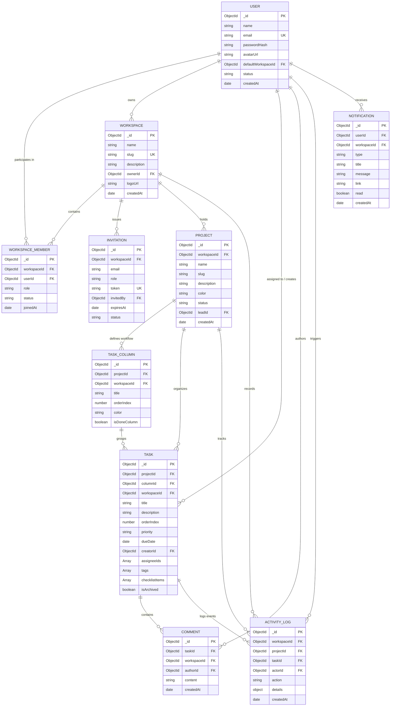

# TeamFlow — Database Design & Data Modeling Specification

**Document Version:** 1.0.0  
**Status:** Approved for Milestone 0  
**Database System:** MongoDB Atlas (Mongoose ODM v8+)  
**Architect:** Senior SaaS Product Architect & Database Engineer  

---

## 1. Database Architecture & Core Tenets

TeamFlow utilizes **MongoDB Atlas** as its persistence layer. The data model is optimized for high-read throughput on Kanban boards, atomic updates on task state transitions, and multi-tenant isolation.

### Key Architectural Tenets:
1. **Multi-Tenant Scoping:** All tenant-specific data (`projects`, `tasks`, `columns`, `comments`, `activity_logs`) carries an explicit `workspaceId` field with a compound index to enforce data boundaries.
2. **Selective Denormalization:** High-frequency read paths (such as user avatar and name in task cards or comments) are selectively denormalized to avoid massive `$lookup` aggregation overhead while preserving relational integrity.
3. **Optimistic Task Ordering:** Task positioning within a column uses indexed fractional ranking numbers (`orderIndex`), allowing single-item updates during drag-and-drop operations rather than updating all items in the column.
4. **Lean Query Defaults:** Read endpoints utilize `.lean()` queries to bypass Mongoose hydration overhead for high-concurrency board requests.

---

## 2. Entity-Relationship Diagram (ERD)



---

## 3. Detailed Collection Schemas

### 3.1 `users` Collection
Stores registered user identities, hashed credentials, and preferences.

```javascript
{
  _id: ObjectId,
  name: { type: String, required: true, trim: true, maxlength: 100 },
  email: { type: String, required: true, unique: true, lowercase: true, trim: true },
  passwordHash: { type: String, required: true, select: false },
  avatarUrl: { type: String, default: "" },
  defaultWorkspaceId: { type: ObjectId, ref: 'Workspace', default: null },
  status: { type: String, enum: ['active', 'suspended', 'pending'], default: 'active' },
  bio: { type: String, maxlength: 300, default: "" },
  jobTitle: { type: String, maxlength: 100, default: "" },
  createdAt: { type: Date, default: Date.now },
  updatedAt: { type: Date, default: Date.now }
}
```
**Indexes:**
- `{ email: 1 }` (Unique)
- `{ createdAt: -1 }`

---

### 3.2 `workspaces` Collection
Top-level multi-tenant container for projects, members, and resources.

```javascript
{
  _id: ObjectId,
  name: { type: String, required: true, trim: true, maxlength: 100 },
  slug: { type: String, required: true, unique: true, lowercase: true, trim: true },
  description: { type: String, maxlength: 500, default: "" },
  ownerId: { type: ObjectId, ref: 'User', required: true, index: true },
  logoUrl: { type: String, default: "" },
  plan: { type: String, enum: ['starter', 'pro', 'enterprise'], default: 'starter' },
  createdAt: { type: Date, default: Date.now },
  updatedAt: { type: Date, default: Date.now }
}
```
**Indexes:**
- `{ slug: 1 }` (Unique)
- `{ ownerId: 1 }`

---

### 3.3 `workspace_members` Collection
Join table capturing membership and role bindings per workspace.

```javascript
{
  _id: ObjectId,
  workspaceId: { type: ObjectId, ref: 'Workspace', required: true },
  userId: { type: ObjectId, ref: 'User', required: true },
  role: { 
    type: String, 
    enum: ['workspace_owner', 'admin', 'project_manager', 'team_member'], 
    default: 'team_member' 
  },
  status: { type: String, enum: ['active', 'inactive'], default: 'active' },
  joinedAt: { type: Date, default: Date.now },
  updatedAt: { type: Date, default: Date.now }
}
```
**Indexes:**
- `{ workspaceId: 1, userId: 1 }` (Unique compound index)
- `{ userId: 1 }`
- `{ workspaceId: 1, role: 1 }`

---

### 3.4 `invitations` Collection
Pending workspace team member invites with secure expiration.

```javascript
{
  _id: ObjectId,
  workspaceId: { type: ObjectId, ref: 'Workspace', required: true },
  email: { type: String, required: true, lowercase: true, trim: true },
  role: { 
    type: String, 
    enum: ['admin', 'project_manager', 'team_member'], 
    default: 'team_member' 
  },
  token: { type: String, required: true, unique: true },
  invitedBy: { type: ObjectId, ref: 'User', required: true },
  status: { type: String, enum: ['pending', 'accepted', 'revoked', 'expired'], default: 'pending' },
  expiresAt: { type: Date, required: true },
  createdAt: { type: Date, default: Date.now }
}
```
**Indexes:**
- `{ token: 1 }` (Unique)
- `{ workspaceId: 1, email: 1, status: 1 }`
- `{ expiresAt: 1 }` (TTL index for automated cleanup)

---

### 3.5 `projects` Collection
Represents a project or initiative containing workflow boards.

```javascript
{
  _id: ObjectId,
  workspaceId: { type: ObjectId, ref: 'Workspace', required: true },
  name: { type: String, required: true, trim: true, maxlength: 120 },
  slug: { type: String, required: true, lowercase: true, trim: true },
  description: { type: String, maxlength: 1000, default: "" },
  color: { type: String, default: "#C85A32" }, // Terracotta default
  status: { type: String, enum: ['active', 'archived', 'completed'], default: 'active' },
  leadId: { type: ObjectId, ref: 'User', default: null },
  createdAt: { type: Date, default: Date.now },
  updatedAt: { type: Date, default: Date.now }
}
```
**Indexes:**
- `{ workspaceId: 1, slug: 1 }` (Unique compound index)
- `{ workspaceId: 1, status: 1 }`

---

### 3.6 `task_columns` Collection
Custom workflow states for a project's Kanban board (e.g. "To Do", "In Progress", "Review", "Done").

```javascript
{
  _id: ObjectId,
  projectId: { type: ObjectId, ref: 'Project', required: true },
  workspaceId: { type: ObjectId, ref: 'Workspace', required: true },
  title: { type: String, required: true, trim: true, maxlength: 60 },
  orderIndex: { type: Number, required: true, default: 0 },
  color: { type: String, default: "#706E69" }, // Warm slate
  isDoneColumn: { type: Boolean, default: false },
  maxTaskLimit: { type: Number, default: 0 }, // 0 = unlimited
  createdAt: { type: Date, default: Date.now },
  updatedAt: { type: Date, default: Date.now }
}
```
**Indexes:**
- `{ projectId: 1, orderIndex: 1 }`
- `{ workspaceId: 1 }`

---

### 3.7 `tasks` Collection
The fundamental atomic unit of work in TeamFlow.

```javascript
{
  _id: ObjectId,
  projectId: { type: ObjectId, ref: 'Project', required: true },
  columnId: { type: ObjectId, ref: 'TaskColumn', required: true },
  workspaceId: { type: ObjectId, ref: 'Workspace', required: true },
  title: { type: String, required: true, trim: true, maxlength: 250 },
  description: { type: String, default: "" },
  orderIndex: { type: Number, required: true, default: 0 },
  priority: { 
    type: String, 
    enum: ['low', 'medium', 'high', 'urgent'], 
    default: 'medium' 
  },
  dueDate: { type: Date, default: null },
  creatorId: { type: ObjectId, ref: 'User', required: true },
  assigneeIds: [{ type: ObjectId, ref: 'User' }],
  tags: [{ type: String, trim: true, maxlength: 30 }],
  checklistItems: [
    {
      _id: { type: ObjectId, default: () => new mongoose.Types.ObjectId() },
      title: { type: String, required: true, trim: true },
      completed: { type: Boolean, default: false },
      completedAt: { type: Date, default: null }
    }
  ],
  isArchived: { type: Boolean, default: false },
  createdAt: { type: Date, default: Date.now },
  updatedAt: { type: Date, default: Date.now }
}
```
**Indexes:**
- `{ columnId: 1, orderIndex: 1 }`
- `{ projectId: 1, isArchived: 1 }`
- `{ workspaceId: 1, assigneeIds: 1 }`
- `{ workspaceId: 1, dueDate: 1 }`
- Text index: `{ title: 'text', description: 'text' }`

---

### 3.8 `comments` Collection
Contextual communication threads attached directly to tasks.

```javascript
{
  _id: ObjectId,
  taskId: { type: ObjectId, ref: 'Task', required: true },
  workspaceId: { type: ObjectId, ref: 'Workspace', required: true },
  authorId: { type: ObjectId, ref: 'User', required: true },
  content: { type: String, required: true, maxlength: 3000 },
  mentions: [{ type: ObjectId, ref: 'User' }],
  createdAt: { type: Date, default: Date.now },
  updatedAt: { type: Date, default: Date.now }
}
```
**Indexes:**
- `{ taskId: 1, createdAt: 1 }`
- `{ workspaceId: 1 }`

---

### 3.9 `activity_logs` Collection
Immutable timeline of events for auditing, tracking, and dashboard feeds.

```javascript
{
  _id: ObjectId,
  workspaceId: { type: ObjectId, ref: 'Workspace', required: true },
  projectId: { type: ObjectId, ref: 'Project', default: null },
  taskId: { type: ObjectId, ref: 'Task', default: null },
  actorId: { type: ObjectId, ref: 'User', required: true },
  action: { 
    type: String, 
    enum: [
      'TASK_CREATED', 'TASK_UPDATED', 'TASK_MOVED', 'TASK_DELETED',
      'COMMENT_ADDED', 'MEMBER_JOINED', 'PROJECT_CREATED', 'PROJECT_ARCHIVED'
    ], 
    required: true 
  },
  details: { type: Object, default: {} },
  createdAt: { type: Date, default: Date.now }
}
```
**Indexes:**
- `{ workspaceId: 1, createdAt: -1 }`
- `{ projectId: 1, createdAt: -1 }`
- `{ taskId: 1, createdAt: -1 }`

---

### 3.10 `notifications` Collection
In-app alerts for direct mentions, task assignments, and status updates.

```javascript
{
  _id: ObjectId,
  userId: { type: ObjectId, ref: 'User', required: true },
  workspaceId: { type: ObjectId, ref: 'Workspace', required: true },
  type: { 
    type: String, 
    enum: ['ASSIGNED', 'MENTIONED', 'DUE_SOON', 'STATUS_CHANGED'], 
    required: true 
  },
  title: { type: String, required: true },
  message: { type: String, required: true },
  link: { type: String, default: "" },
  read: { type: Boolean, default: false },
  createdAt: { type: Date, default: Date.now }
}
```
**Indexes:**
- `{ userId: 1, read: 1, createdAt: -1 }`
- `{ workspaceId: 1 }`

---

## 4. Deletion & Data Retention Policies

1. **Workspace Deletion:** Cascades down to delete all associated projects, columns, tasks, comments, memberships, and invitations using a background transactional job.
2. **Project Archival vs. Deletion:** Projects default to `status: 'archived'` rather than hard deletion to prevent accidental loss of task history. Hard deletion is restricted to Workspace Owners.
3. **Task Deletion:** Soft deletion (`isArchived: true`) retains task audit trail; permanent deletion cleans up associated comments and activity references.
4. **Member Removal:** Revoking a member updates their membership record to `inactive` without deleting tasks or comments authored by that member.
