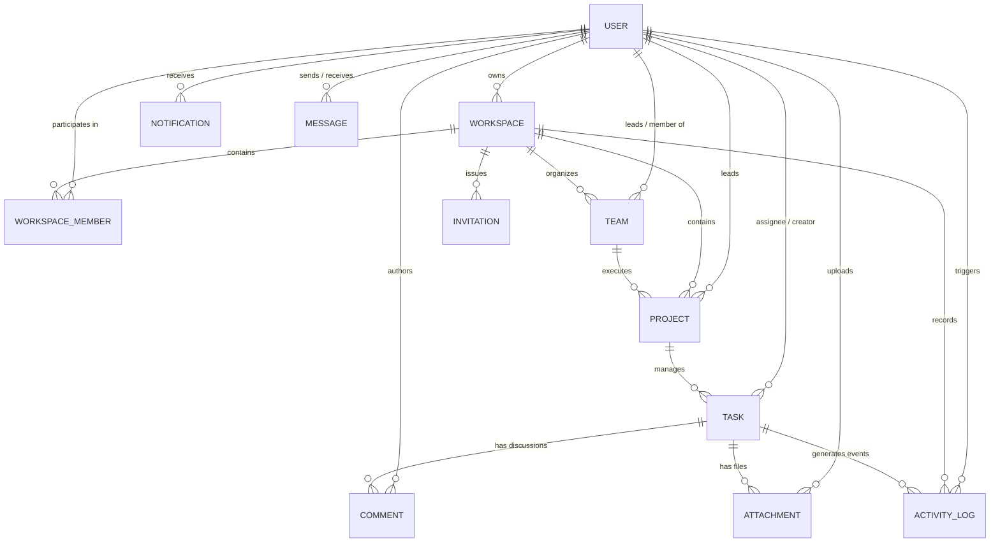

# TeamFlow — Database Design & Data Modeling Specification

**Document Version:** 1.2.0  
**Status:** Approved for Milestone 3  
**Database System:** MongoDB Atlas (Mongoose ODM v8+)  
**Architect:** Senior Node.js & Database Architect  

---

## 1. Database Architecture & Core Tenets

TeamFlow utilizes **MongoDB Atlas** as its persistence layer. The data model is optimized for high-read throughput on Kanban boards, atomic updates on task state transitions, and strict multi-tenant isolation.

### Key Architectural Tenets:
1. **Multi-Tenant Scoping:** All tenant-specific collections carry an explicit `workspaceId` field with a compound index to strictly isolate tenant data.
2. **Selective Denormalization:** High-frequency read paths (such as user avatar and name in task cards or comments) are selectively populated to prevent massive unindexed aggregation overhead.
3. **Optimistic Task Ordering:** Task positioning within a column uses indexed fractional ranking numbers (`orderIndex`), allowing single-item updates during drag-and-drop operations rather than rewriting all adjacent cards.
4. **Avoid Unbounded Arrays:** Comments, messages, activity logs, and attachments are kept in separate collections referencing their parent entity (`taskId`, `projectId`, or `workspaceId`) with compound indexes, avoiding the 16MB document size limit.

---

## 2. Entity-Relationship Diagram (12 Core Collections)

---

## 3. The 12 Mongoose Models

| # | Model | Collection | Primary Responsibility | Index Strategy |
| :-: | :--- | :--- | :--- | :--- |
| **1** | `User` | `users` | User identity, password hash (`bcryptjs`), avatar, and profile bio. | `{ email: 1 }` (unique), `{ status: 1 }` |
| **2** | `Workspace` | `workspaces` | Multi-tenant organizational container, slug, plan, and owner reference. | `{ slug: 1 }` (unique), `{ ownerId: 1, createdAt: -1 }` |
| **3** | `WorkspaceMember` | `workspacemembers` | Join table binding users to workspaces with 4-tier RBAC roles. | `{ workspaceId: 1, userId: 1 }` (unique), `{ workspaceId: 1, role: 1 }` |
| **4** | `Team` | `teams` | Functional squads (e.g. Design, Frontend) within a workspace. | `{ workspaceId: 1, name: 1 }` (unique) |
| **5** | `Project` | `projects` | Initiatives containing boards, sprint roadmaps, and team assignments. | `{ workspaceId: 1, slug: 1 }` (unique), `{ workspaceId: 1, status: 1 }` |
| **6** | `Task` | `tasks` | Atomic workflow card with column state, priority, fractional order, and checklists. | `{ projectId: 1, column: 1, orderIndex: 1 }`, `{ workspaceId: 1, assigneeIds: 1 }` |
| **7** | `Comment` | `comments` | Contextual discussion threads on tasks. | `{ taskId: 1, createdAt: 1 }`, `{ workspaceId: 1 }` |
| **8** | `Notification` | `notifications` | In-app alerts for assignments, mentions, and system updates. | `{ userId: 1, read: 1, createdAt: -1 }` |
| **9** | `Message` | `messages` | Direct teammate and channel messaging within a workspace. | `{ workspaceId: 1, channelId: 1, createdAt: -1 }`, `{ senderId: 1, recipientId: 1 }` |
| **10** | `Invitation` | `invitations` | Pending tokenized invitations for new teammates. | `{ token: 1 }` (unique), `{ expiresAt: 1 }` (TTL index auto-deletes) |
| **11** | `Attachment` | `attachments` | File metadata, CDN links, and file size metrics. | `{ taskId: 1, createdAt: -1 }`, `{ workspaceId: 1 }` |
| **12** | `ActivityLog` | `activitylogs` | Immutable audit stream tracking workspace, project, and task transitions. | `{ workspaceId: 1, createdAt: -1 }`, `{ projectId: 1, createdAt: -1 }` |

---

## 4. Indexing & Query Optimization Strategy

1. **Compound Indexes for Multi-Tenant Scoping:**
   - Every read and write query filters on `workspaceId`. Compound indexes ensure index-only scans without in-memory sorting.
   - Example on Tasks: `{ projectId: 1, column: 1, orderIndex: 1 }` supports instant Kanban column card retrieval in exact order.
2. **Text Search Index:**
   - Tasks collection utilizes a compound text index `{ title: 'text', description: 'text' }` for sub-50ms search query resolution.
3. **Automated TTL Indexes:**
   - Pending invitations carry `{ expiresAt: 1 }` with `{ expireAfterSeconds: 0 }`, allowing MongoDB to automatically sweep and delete expired tokens.
4. **Anti-Leakage Security Verification:**
   - All controller queries use parameterized Mongoose filters where `workspaceId` is derived exclusively from the verified JWT membership context (`req.workspaceId`), never trusting client payloads.
