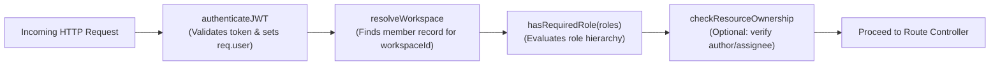

# TeamFlow — Role-Based Access Control (RBAC) & Permissions Specification

**Document Version:** 1.0.0  
**Status:** Approved for Milestone 0  
**Security Lead / Architect:** Senior SaaS Product Architect  

---

## 1. Overview & RBAC Principles

TeamFlow implements a role-based access control (RBAC) model scoped at the **Workspace** level, supplemented by fine-grained **Resource-Level** checks (such as comment authorship or task creation).

### Core Security Principles:
1. **Principle of Least Privilege:** Users are granted only the permissions required to fulfill their specific role.
2. **Strict Multi-Tenant Scoping:** All permission checks evaluate whether the target resource resides in the workspace the user is currently operating in.
3. **No Cross-Tenant Role Leaks:** A user may be an `admin` in Workspace A and a `team_member` in Workspace B; permissions are never inherited across workspace boundaries.
4. **Owner Safeguards:** The `workspace_owner` role possesses ultimate organizational authority, cannot be removed by other admins, and requires an explicit transfer of ownership before account deletion.

---

## 2. Role Definitions

| Role Identifier | Role Title | Description & Target User |
| :--- | :--- | :--- |
| `workspace_owner` | **Workspace Owner** | Creator of the workspace or designated organization lead. Full control over billing, security, membership, deletion, and all workspace projects. |
| `admin` | **Administrator** | Trusted operations or department leads. Can manage team members, invite new users, create and archive projects, and manage all task boards. |
| `project_manager` | **Project Manager** | Team leads, product managers, or scrum masters. Can create projects, customize workflow columns, assign tasks, manage sprints, and moderate comments. |
| `team_member` | **Team Member** | Core contributors (engineers, designers, content creators). Can create and update tasks, move cards between columns, post comments, and manage checklists. |

---

## 3. Granular Permission Matrix

| Capability / Action | Workspace Owner | Admin | Project Manager | Team Member |
| :--- | :---: | :---: | :---: | :---: |
| **Workspace Governance** | | | | |
| Delete workspace | :white_check_mark: | :x: | :x: | :x: |
| Update workspace settings & name | :white_check_mark: | :white_check_mark: | :x: | :x: |
| Transfer workspace ownership | :white_check_mark: | :x: | :x: | :x: |
| View workspace audit/activity logs | :white_check_mark: | :white_check_mark: | :white_check_mark: | :white_check_mark: |
| **Member & Role Management** | | | | |
| Send invitation to new members | :white_check_mark: | :white_check_mark: | :x: | :x: |
| Revoke pending invitations | :white_check_mark: | :white_check_mark: | :x: | :x: |
| Change member role (Owner &rarr; Admin/PM/Member) | :white_check_mark: | :x: | :x: | :x: |
| Change member role (Admin &rarr; PM/Member) | :white_check_mark: | :white_check_mark: | :x: | :x: |
| Remove member from workspace | :white_check_mark: | :white_check_mark: | :x: | :x: |
| **Project & Board Management** | | | | |
| Create new project | :white_check_mark: | :white_check_mark: | :white_check_mark: | :x: |
| Update project settings / name / color | :white_check_mark: | :white_check_mark: | :white_check_mark: | :x: |
| Archive / Unarchive project | :white_check_mark: | :white_check_mark: | :white_check_mark: | :x: |
| Permanently delete project | :white_check_mark: | :white_check_mark: | :x: | :x: |
| Add / Edit / Reorder Kanban columns | :white_check_mark: | :white_check_mark: | :white_check_mark: | :x: |
| Delete Kanban column (and transfer tasks) | :white_check_mark: | :white_check_mark: | :white_check_mark: | :x: |
| **Task Management** | | | | |
| Create new task | :white_check_mark: | :white_check_mark: | :white_check_mark: | :white_check_mark: |
| Edit task details (title, description, tags) | :white_check_mark: | :white_check_mark: | :white_check_mark: | :white_check_mark: |
| Move task across columns (drag & drop) | :white_check_mark: | :white_check_mark: | :white_check_mark: | :white_check_mark: |
| Assign / Reassign task members | :white_check_mark: | :white_check_mark: | :white_check_mark: | :white_check_mark: |
| Update task priority & due date | :white_check_mark: | :white_check_mark: | :white_check_mark: | :white_check_mark: |
| Toggle checklist items | :white_check_mark: | :white_check_mark: | :white_check_mark: | :white_check_mark: |
| Archive / Delete task | :white_check_mark: | :white_check_mark: | :white_check_mark: | Self-created only |
| **Discussions & Comments** | | | | |
| Post comment on task | :white_check_mark: | :white_check_mark: | :white_check_mark: | :white_check_mark: |
| Edit own comment | :white_check_mark: | :white_check_mark: | :white_check_mark: | :white_check_mark: |
| Delete own comment | :white_check_mark: | :white_check_mark: | :white_check_mark: | :white_check_mark: |
| Delete any comment (Moderation) | :white_check_mark: | :white_check_mark: | :white_check_mark: | :x: |

---

## 4. Middleware & Policy Evaluation Logic

### 4.1 Authorization Middleware Pipeline
Access control is implemented in Express via a two-stage middleware design:



### 4.2 Middleware Pseudocode Specification

```typescript
// backend/src/middlewares/auth.middleware.js
export const requireWorkspaceRole = (allowedRoles: string[]) => {
  return async (req, res, next) => {
    const workspaceId = req.params.workspaceId || req.body.workspaceId || req.headers['x-workspace-id'];
    const userId = req.user._id;

    if (!workspaceId) {
      return res.status(400).json({ success: false, error: "Workspace context is required." });
    }

    const membership = await WorkspaceMember.findOne({
      workspaceId,
      userId,
      status: 'active'
    });

    if (!membership) {
      return res.status(403).json({ success: false, error: "Access denied. Not a member of this workspace." });
    }

    if (!allowedRoles.includes(membership.role)) {
      return res.status(403).json({ 
        success: false, 
        error: `Insufficient permissions. Required one of: [${allowedRoles.join(', ')}]` 
      });
    }

    // Attach membership context for controllers
    req.workspaceMember = membership;
    next();
  };
};
```

---

## 5. Security Invariants & Edge Case Safeguards

1. **Anti-Self-Demotion Safeguard:** A workspace owner cannot change their own role or remove themselves without first transferring ownership to another active member.
2. **Privilege Escalation Prevention:**
   - An `admin` cannot grant the `workspace_owner` role.
   - An `admin` cannot promote another member to `admin` without having explicit administrative permissions.
   - A `project_manager` or `team_member` cannot alter member roles or send invitations.
3. **Ghost Workspace Prevention:** A workspace cannot have zero active owners. If an owner attempts to delete their account, the system prompts them to designate a new owner or delete the workspace entirely.
4. **Tombstoning & Audit Preservation:** When a member is removed from a workspace, tasks and comments created by that user retain their references (displaying user name and `[Removed Member]` badge) rather than causing null pointer errors.
