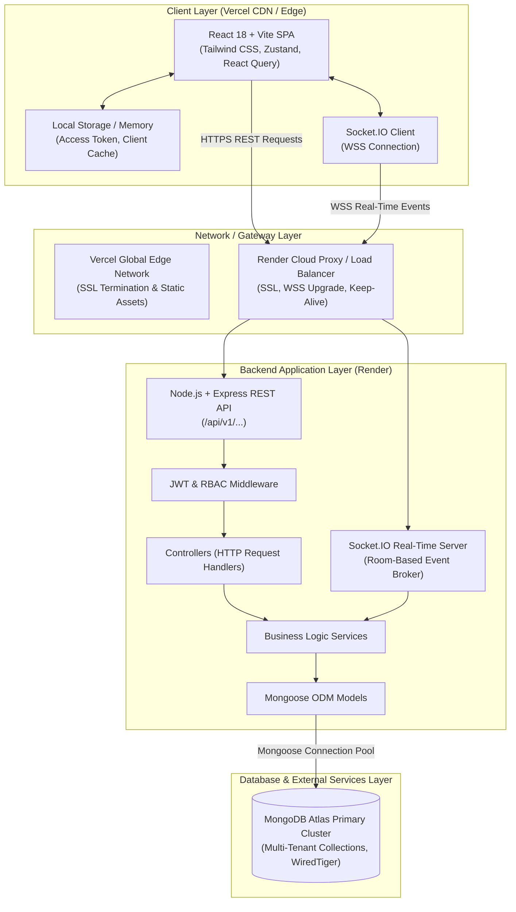
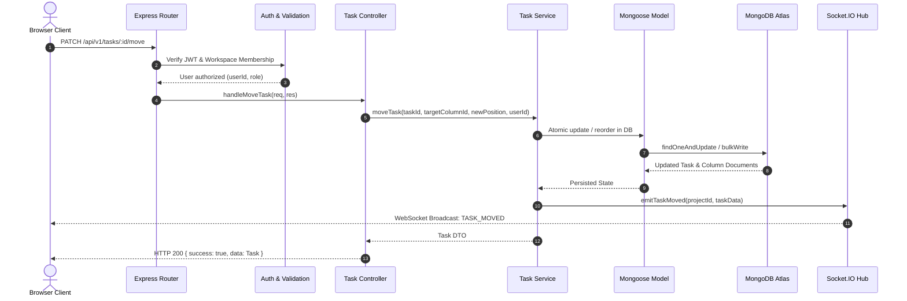

# TeamFlow — System Architecture Document

**Document Version:** 1.0.0  
**Status:** Approved for Milestone 0  
**Architect:** Senior SaaS Product Architect & Full-Stack Engineer  

---

## 1. High-Level Architectural Overview

TeamFlow follows a modern, decoupled client-server architecture organized within a clean monorepo. The application is built for high responsiveness, sub-100ms real-time collaboration, and strict multi-tenant workspace isolation.



---

## 2. Monorepo Organization

The project is structured as a unified monorepo with explicit boundaries between the frontend application, backend service, and architectural documentation.

```
teamflow/
├── docs/                             # Architecture, API specs, schemas, design system
│   ├── PRODUCT_REQUIREMENTS.md
│   ├── SYSTEM_ARCHITECTURE.md
│   ├── DATABASE_DESIGN.md
│   ├── API_SPECIFICATION.md
│   ├── USER_FLOWS.md
│   ├── ROLE_PERMISSIONS.md
│   ├── DESIGN_SYSTEM.md
│   └── DEPLOYMENT_PLAN.md
├── backend/                          # Node.js + Express + Socket.IO API
│   ├── src/
│   │   ├── config/                   # Database, environment, and constants
│   │   ├── controllers/              # Request parsing, HTTP status responses
│   │   ├── middlewares/              # Auth, RBAC, validation, rate limiting, error handling
│   │   ├── models/                   # Mongoose schemas, indexes, and hooks
│   │   ├── routes/                   # Express router definitions (/api/v1/...)
│   │   ├── services/                 # Core business logic and database mutations
│   │   ├── sockets/                  # Socket.IO connection handlers and room managers
│   │   ├── utils/                    # JWT helpers, formatters, API response envelopes
│   │   ├── validators/               # Request payload validation schemas
│   │   └── server.js                 # HTTP server bootstrap and graceful shutdown
│   ├── .env.example                  # Backend environment template
│   ├── package.json
│   └── README.md
├── frontend/                         # React 18 + Vite SPA
│   ├── public/                       # Static favicons, fonts, and assets
│   ├── src/
│   │   ├── assets/                   # SVG icons, illustrations
│   │   ├── components/               # Reusable UI component library
│   │   │   ├── common/               # Buttons, Inputs, Modals, Badges, Dropdowns
│   │   │   ├── feedback/             # Spinners, Toast notifications, Empty states
│   │   │   ├── layout/               # Sidebar, Header, Workspace switcher, Breadcrumbs
│   │   │   └── kanban/               # Column, TaskCard, TaskDetailModal, Checklists
│   │   ├── context/                  # AuthContext, ThemeContext, SocketContext
│   │   ├── hooks/                    # Custom React hooks (useAuth, useKanban, useSocket)
│   │   ├── pages/                    # Route-level views (Login, Register, Board, Settings)
│   │   ├── services/                 # Axios HTTP client, API wrappers, Socket client
│   │   ├── store/                    # Zustand global stores (workspace, UI, active board)
│   │   ├── styles/                   # Tailwind config, custom CSS tokens, typography
│   │   ├── utils/                    # Date formatters, color mappers, validators
│   │   ├── App.jsx                   # Route hierarchy and providers
│   │   └── main.jsx                  # React DOM mount point
│   ├── .env.example                  # Frontend environment template
│   ├── index.html
│   ├── package.json
│   ├── tailwind.config.js
│   ├── vite.config.js
│   └── README.md
└── README.md                         # Monorepo root guide & orchestration
```

---

## 3. Frontend Architecture (React + Vite)

### 3.1 Technology Selection
- **Build Tool:** Vite 5+ (instant HMR, fast Rollup production builds, tree-shaking).
- **Core Framework:** React 18 (Concurrent features, Strict Mode).
- **Styling:** Tailwind CSS with an extended theme system defining TeamFlow's custom warm design tokens (Warm Ivory, Terracotta, Sage Green, Warm Charcoal).
- **Icons:** `lucide-react` (clean, accessible, tree-shakeable stroke icons).
- **Drag-and-Drop:** `@hello-pangea/dnd` or HTML5 Drag & Drop with clean, accessible touch/pointer support for Kanban board columns and tasks.

### 3.2 State Management Strategy
TeamFlow utilizes a dual-tier state strategy:
1. **Server State (TanStack Query / Axios interceptors):** Handles remote data fetching, automatic background caching, query invalidation, and garbage collection.
2. **Client State (Zustand):** Lightweight, zero-boilerplate stores for ephemeral UI state:
   - `authStore`: Current user identity, active workspace ID, authentication status.
   - `boardStore`: Active project board columns and task cache with optimistic mutation helpers.
   - `uiStore`: Modal states, sidebar collapse toggle, active filter presets.

### 3.3 Routing & Layout Hierarchy
React Router v6 provides nested, declarative route definitions:
- **Public Routes:** `/login`, `/register`, `/forgot-password`, `/invite/:token` (Wrapped in `GuestLayout`).
- **Protected Workspace Routes:** `/workspaces`, `/workspaces/:workspaceId/dashboard`, `/workspaces/:workspaceId/projects/:projectId`, `/workspaces/:workspaceId/settings`, `/workspaces/:workspaceId/members` (Wrapped in `AppLayout` with persistent Sidebar and Header).

---

## 4. Backend Architecture (Node.js + Express)

### 4.1 Layered Service Pattern
The Express application strictly adheres to the **Controller-Service-Model** pattern to separate transport protocols from core domain logic.



### 4.2 Middleware Pipeline
Every incoming request flows through an ordered middleware chain:
1. `helmet()`: Security response headers (Content-Security-Policy, X-Frame-Options).
2. `cors(corsOptions)`: Origin whitelist matching `FRONTEND_URL`.
3. `express.json({ limit: '1mb' })`: Safe JSON body parsing.
4. `rateLimiter`: Protection against brute-force attacks on auth routes (100 reqs / 15 mins).
5. `authenticateJWT`: Extracts Bearer token, verifies signature, hydrates `req.user`.
6. `requireWorkspaceRole([...roles])`: Verifies that `req.user` has sufficient permissions for the requested workspace/resource.
7. `validate(schema)`: Validates body, query, and path params using standard schema validators.
8. `errorHandler`: Global catch-all middleware ensuring errors return uniform JSON envelopes without leaking stack traces in production.

---

## 5. Real-Time Communication Architecture (Socket.IO)

### 5.1 Connection & Authentication Handshake
Clients establish a WebSocket connection via Socket.IO:
- Handshake carries the JWT token in `auth.token`.
- Backend socket middleware verifies the JWT before completing the handshake.
- Unauthenticated socket attempts are rejected with an explicit error code.

### 5.2 Room Isolation Topology
To avoid global event storms, WebSockets are strictly scoped using rooms:
- **`workspace:{workspaceId}`**: Used for workspace-level updates (member invited, project created/archived).
- **`project:{projectId}`**: Used for board-level updates (card moved, column created, task edited, live typing/active viewers).
- **`user:{userId}`**: Dedicated personal channel for direct notifications and mentions.

### 5.3 Event Matrix & Payloads
| Event Name | Scope / Room | Direction | Purpose |
| :--- | :--- | :--- | :--- |
| `project:join` | `project:{projectId}` | Client &rarr; Server | Client enters board view; joins room. |
| `project:leave` | `project:{projectId}` | Client &rarr; Server | Client navigates away from board. |
| `task:created` | `project:{projectId}` | Server &rarr; Client | Notifies active viewers of a newly added task. |
| `task:moved` | `project:{projectId}` | Server &rarr; Client | Real-time card position or column shift. |
| `task:updated` | `project:{projectId}` | Server &rarr; Client | Field update (title, assignee, priority, checklist). |
| `task:deleted` | `project:{projectId}` | Server &rarr; Client | Card removal from column. |
| `comment:added` | `project:{projectId}` | Server &rarr; Client | Live comment posted on a task. |
| `notification:new` | `user:{userId}` | Server &rarr; Client | Personal notification delivered in real time. |

---

## 6. Security Architecture & Threat Mitigation

### 6.1 Authentication & Session Management
- **Token Architecture:**
  - **Access Tokens:** Short-lived JWT (15-minute expiration) carrying `{ userId, email }`, passed via `Authorization: Bearer <token>` in-memory.
  - **Refresh Tokens:** Long-lived (7-day TTL), signed JWT carrying `{ userId, familyId, tokenId }`. Stored exclusively in secure, HttpOnly, SameSite cookies (`teamflow_refresh_token`). Refresh tokens are never exposed in JSON response bodies.
  - **Rotation & Reuse Detection:** Every refresh operation rotates the token within its `familyId` lineage. If an already-rotated or revoked token is presented again (indicating token theft or replay attack), the system immediately detects reuse and revokes ALL tokens in that family lineage (`403 REFRESH_TOKEN_REUSE_DETECTED`).
  - **Session Model:** Backed by the `RefreshToken` Mongoose collection with MongoDB TTL auto-cleanup indexes.
- **Transactional Email & Brevo API:**
  - Integrated with Brevo (Sendinblue) transactional email API (`https://api.brevo.com/v3/smtp/email`) for email verification, two-factor authentication OTP, and single-use password recovery.
  - Graceful dev/test fallback: When `BREVO_API_KEY` is omitted, the service cleanly logs generated 6-digit OTP codes to the server console with full diagnostic details without failing.
- **Password Protection & Anti-Enumeration:**
  - Passwords hashed using `bcrypt` (12 salt rounds).
  - Anti-user-enumeration on `/auth/forgot-password` and `/auth/resend-verification` (always returns consistent generic success envelopes).
  - Password reset automatically invalidates all active sessions for the user.

### 6.2 Multi-Tenant Data Isolation
To prevent cross-tenant leakage:
- Every query accessing projects, columns, tasks, comments, and members must include `workspaceId: req.workspace._id`.
- Model-level helper guards verify that child entities (e.g. task) belong to the targeted project and workspace.

### 6.3 Security Controls Checklist
- [x] CORS configured strictly for trusted origins (`FRONTEND_URL`).
- [x] Rate limiting on authentication routes (login, register, forgot-password).
- [x] Helmet headers enabled to block cross-site scripting (XSS) and clickjacking.
- [x] Input sanitization to prevent NoSQL injection (rejecting `$where`, `$gt` operators in user inputs).
- [x] Zero credential exposure: MongoDB URIs and JWT secrets loaded strictly through environment variables.

---

## 7. Scalability & Operational Trade-Offs

| Decision | Selected Option | Alternative Considered | Rationale & Trade-Off |
| :--- | :--- | :--- | :--- |
| **Monorepo Structure** | Independent `/frontend` and `/backend` directories | Monorepo tools (Turborepo/Nx) or Separate Repos | Zero complex tooling dependencies; straightforward to deploy separately on Vercel and Render while maintaining atomic Git history. |
| **Real-Time Engine** | Socket.IO | Server-Sent Events (SSE) or Raw WebSockets | Socket.IO provides battle-tested room management, automatic reconnection with exponential backoff, and WebSocket fallback out-of-the-box. |
| **State Management** | Zustand + Axios / TanStack | Redux Toolkit | Zustand provides minimal bundle footprint (~1kB), zero boilerplate, and immediate intuitive developer ergonomics for team collaboration state. |
| **Card Ordering** | Lexicographical / Fractional Ordering | Integer Sequence (1, 2, 3...) | Reordering a card between two items only updates the single moved item's rank instead of triggering a massive database write across all subsequent cards. |
