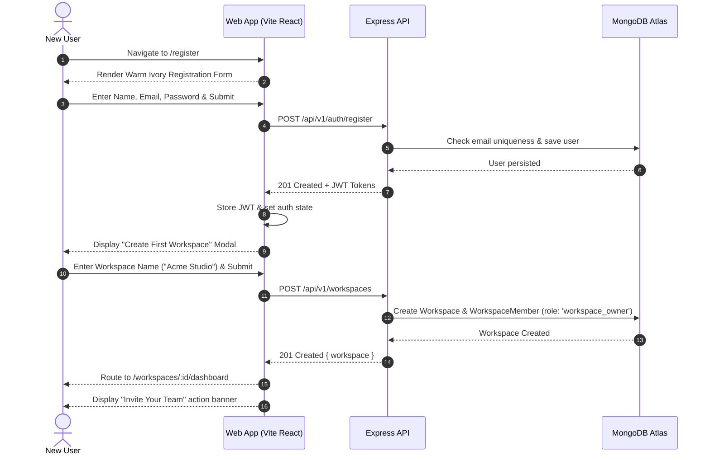
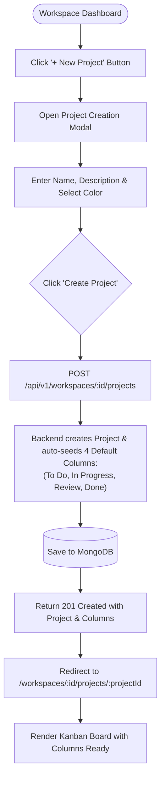
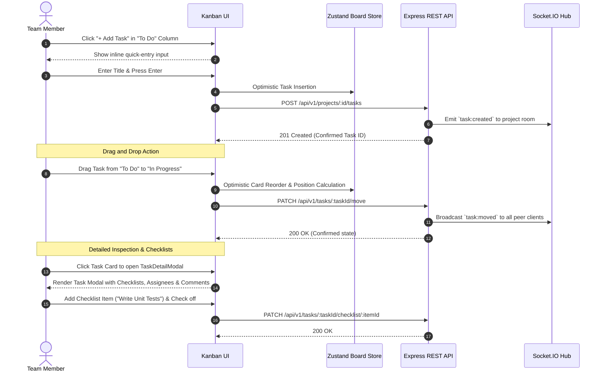
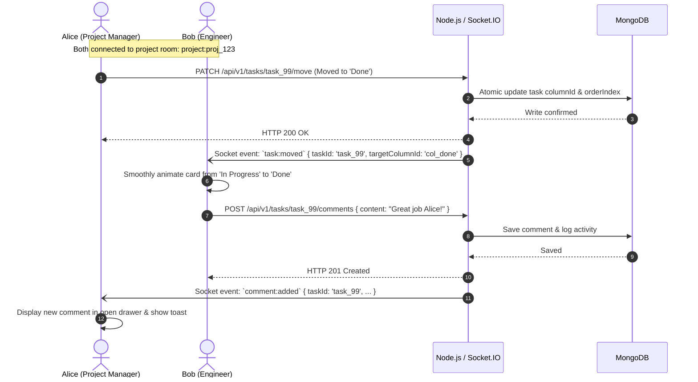
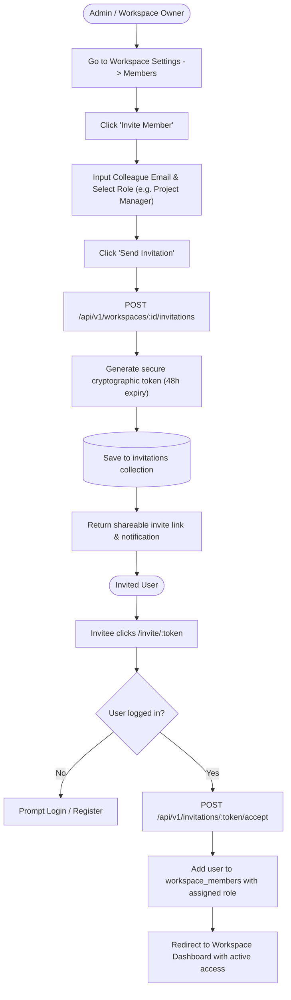
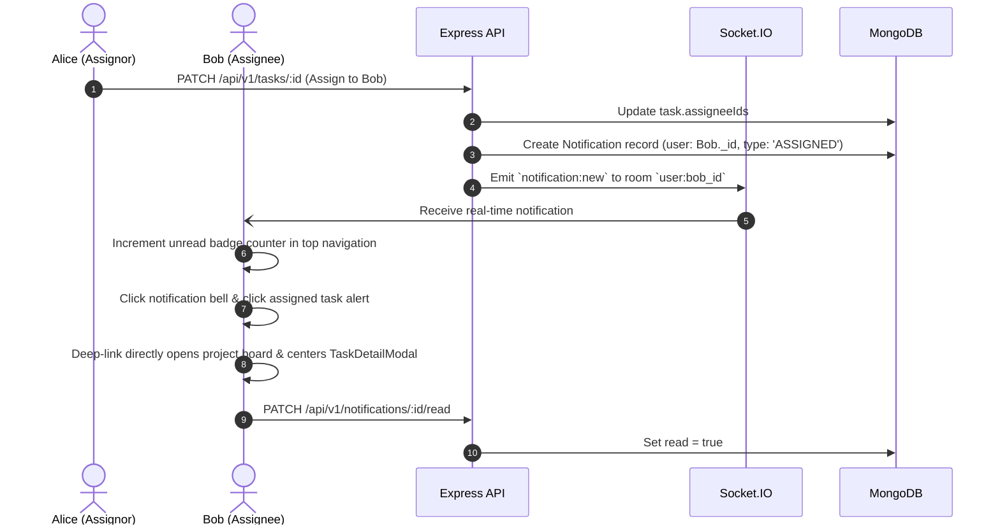

# TeamFlow — User Flows & Interaction Workflows

**Document Version:** 1.0.0  
**Status:** Approved for Milestone 0  
**UX & Product Lead:** Senior SaaS Product Architect & UI/UX Designer  

---

## 1. Flow 1: User Onboarding & Workspace Initialization

This flow illustrates the user journey from initial arrival to fully provisioned workspace and initial team invitation.

---

## 2. Flow 2: Project Creation & Kanban Workflow Setup

---

## 3. Flow 3: Complete Task Lifecycle (Creation &rarr; Movement &rarr; Completion)

---

## 4. Flow 4: Real-Time Multi-User Collaboration & Synchronization

Demonstrates how two concurrent users collaborate on the same Kanban board without collision or stale state.

---

## 5. Flow 5: Team Member Invitation & Role Assignment

---

## 6. Flow 6: In-App Notifications & Deep-Link Resolution

---

## 7. Edge Cases & Resilience Flows

### 7.1 WebSocket Connection Interruption & Auto-Reconnection
1. **Drop Detection:** Socket.IO client detects heartbeat timeout or network offline event.
2. **Visual Indicator:** Top bar displays a subtle, non-intrusive status pill: *"Reconnecting..."*
3. **Exponential Backoff:** Client attempts reconnection at intervals of 1s, 2s, 5s, 10s.
4. **Resync on Reconnect:** Upon re-establishing the socket connection, the client triggers a background revalidation query (`GET /api/v1/projects/:id`) to reconcile any card moves that took place while disconnected.
5. **Success State:** Status pill transitions to *"Connected"* (Sage Green) and smoothly fades out.

### 7.2 Concurrent Move Resolution
- If two users move the same task simultaneously, the server processes the operations sequentially using atomic MongoDB updates.
- The latest completed operation broadcasts its canonical state via `task:moved`, causing all connected clients to reconcile to the server's single source of truth.
